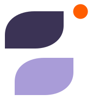

<div align="center">



# saans

**Everyone deserves someone to talk to.**

A calm emotional-support companion that listens by voice or text, in 15 Indian languages. This repo is the marketing site:
light and dark themes, glass pop-ups, a one-minute breathing exercise, scroll-driven motion
and a phone-first bottom dock.


</div>

---

## Contents

- [Screenshots](#screenshots)
- [Features](#features)
- [Tech stack](#tech-stack)
- [Getting started](#getting-started)
- [Project structure](#project-structure)
- [Design system](#design-system)
- [Responsive behaviour](#responsive-behaviour)
- [Pop-ups](#pop-ups)
- [Motion](#motion)
- [Accessibility](#accessibility)
- [Deployment](#deployment)
- [Implementation notes](#implementation-notes)
- [Design reference](#design-reference)

---

## Screenshots

### Light and dark

| Light | Dark |
|---|---|
|  |  |

### Sections

| What it does | Who it's for |
|---|---|
|  |  |

| Your journey | Privacy & safety |
|---|---|
|  |  |

### Pop-ups

| Coming soon | 1-minute breath | Professional care |
|---|---|---|
|  |  |  |

### Phone

| Hero | Menu | Bottom dock (dark) |
|---|---|---|
|  |  |  |

<details>
<summary><strong>Full page (desktop, light)</strong></summary>


</details>

---

## Features

- **Eight sections:** Hero, What it does (bento grid), Who it's for, Professional care, Your journey, Privacy & safety, Our story and a closing breath call-to-action.
- **Light and dark themes:** follows the OS until you pick one, remembers the choice in `localStorage` (`saans-theme`), and applies it before the first paint, so there's no flash. Switching uses a circular reveal from the toggle.
- **Seven glass pop-ups:** Coming soon, Breath, Professional care, Privacy, Who it's for, What it does and crisis Help. They share one shell with an animated scrim, drifting blobs and staggered content.
- **Breathing exercise:** a progress ring and scaling orb guide six slow breaths, 4 seconds in and 4 seconds out.
- **Live hero demo:** an example conversation types itself out on a loop, and the card tilts toward the pointer.
- **Scroll motion:** reveals, light parallax, a hero that eases back as you scroll, and growing panels.
- **Phone dock:** a floating glass tab bar under 1000px that slides in after the hero and highlights the current section.
- **No images:** every visual is CSS or inline SVG, apart from the screenshots in this README.

## Tech stack

| | |
|---|---|
| Framework | [Next.js 16](https://nextjs.org) App Router, statically prerendered |
| UI | React 19, TypeScript (strict) |
| Styling | CSS Modules + CSS custom properties (design tokens) |
| Font | Comfortaa via `next/font/google` |
| Motion | CSS keyframes + Web Animations API, no animation library |
| Dependencies | `next`, `react` and `react-dom` only |

## Getting started

You need **Node.js 20 or newer** (built and tested on Node 24).

```bash
git clone https://github.com/<your-username>/<your-repo>.git
```
```bash
cd <your-repo>
```
```bash
npm install
```
```bash
npm run dev
```

Then open <http://localhost:3000>.

| Script | What it does |
|---|---|
| `npm run dev` | Start the dev server with hot reload |
| `npm run build` | Create a production build |
| `npm start` | Serve the production build (run `build` first) |

## Project structure

```
src/
  app/
    layout.tsx           <html>, Comfortaa font, theme bootstrap script, metadata
    page.tsx             composes the sections in order
    globals.css          tokens (light + dark), resets, @keyframes, laptop zoom rules
    icon.svg             favicon
  components/
    UIProvider.tsx       page state: open pop-up, menu, active section, scroll helper
    Motion.tsx           mounts scroll reveals, parallax and the press ripple
    Header.tsx           sticky glass header, nav, theme toggle, phone menu
    Hero.tsx             headline, CTAs, live chat card, breathing orb
    WhatItDoes.tsx       bento cards: chat, languages marquee, breathe, patterns, voice
    WhoItsFor.tsx        three orbs (01/02/03) on a connecting line
    ProfessionalCare.tsx steps + floating demo cards (simplified stack on phones)
    Journey.tsx          eight steps: snake path ≥980px, vertical list below
    Privacy.tsx          settings-card demo + "Memory cleared" chip
    Story.tsx            quote card, promise pills, vision card with flower visual
    BreathCTA.tsx        closing headline over breathing rings
    Footer.tsx
    MobileDock.tsx       floating bottom tab bar (<1000px)
    icons.tsx            inline SVG icons and the logo
    ui.module.css        shared section, eyebrow and heading styles
    modals/
      GlassModal.tsx     shared shell: scrim, blobs, glass card, enter/exit motion
      Modals.tsx         mounts every pop-up
      ComingSoonModal.tsx  BreathModal.tsx  CareModal.tsx
      PrivacyModal.tsx     ForModal.tsx     HowModal.tsx   HelpModal.tsx
  hooks/
    useTheme.ts          light/dark with persistence and OS fallback
    useReveal.ts         IntersectionObserver reveals + scroll-linked parallax
    useActiveSection.ts  which section is in view (nav + dock highlight)
    useBreathing.ts      breathing timer state machine
docs/screenshots/        images used in this README
design_handoff_saans_nextjs/  original HTML prototype and handoff notes
```

## Design system

All colours are CSS variables in [`src/app/globals.css`](src/app/globals.css). Dark mode redefines them under `[data-theme="dark"]`.

| Token | Light | Dark | Used for |
|---|---|---|---|
| `--bg` | `#F3F0F8` | `#1C1828` | Page background |
| `--surface` | `#FFFFFF` | `#241F33` | Cards |
| `--text` | `#2E2747` | `#EEEAF6` | Body text |
| `--text2` | `#514A69` | `#B9B1CF` | Secondary text |
| `--primary` | `#4E4475` | `#C9C0E6` | Buttons, accents |
| `--accent` | `#A99CD8` | `#B9B0D9` | Highlights, orbs |
| `--soft1` | `#E3DDF1` | `#2A2440` | Tinted panels |
| `--soft2` | `#EFD2C9` | `#2F2944` | Warm panels |
| `--deep` | `#3B3355` | `#302A47` | Dark cards, panels |
| `--dot` | `#FF5E00` | `#FF5E00` | Brand dot |

**Type:** Comfortaa 300–700. Body 16px / 1.68. Headings use fluid sizes, e.g. H2 `clamp(30px, 3.8vw, 48px)` and hero H1 `clamp(36px, 5.2vw, 62px)`.

**Shape and easing:** pills `999px`, cards `clamp(26px, 3.4vw, 36px)`; standard easing `cubic-bezier(.22, 1, .36, 1)`.

## Responsive behaviour

| Width | Change |
|---|---|
| < 640px | Care visual becomes a simple stack; "Memory cleared" chip hidden |
| < 980px | Journey switches from the snake path to a vertical list |
| < 1000px | Bottom dock appears; footer gets extra bottom space for it |
| < 1080px | Header nav collapses into the menu button |
| ≥ 1000px | Page is scaled with `zoom` (.9 → .74 depending on height) so small laptops don't look zoomed in |

Layouts are fluid in between (`repeat(auto-fit, minmax(min(100%, N), 1fr))` grids and `clamp()` sizes). The breakpoints are CSS media queries, so the server-rendered HTML is already right and nothing jumps on load.

## Pop-ups

| Opened by | Pop-up |
|---|---|
| Start talking, Talk, Try voice, Try it now | **Coming soon:** voice and text chat isn't live yet |
| Try a 1-minute breath, Breathe with me | **Breath:** guided six-breath exercise |
| See how it works, Professionals (nav) | **Professional care:** steps, booking demo, who you can talk to |
| All privacy details, Privacy (nav) | **Privacy:** controls demo and six commitments |
| What it does (nav) | **What it does:** the five features in detail |
| Who it's for (nav) | **Who it's for:** three levels of support |
| Get Help. (footer) | **Help:** crisis lines (112, Tele-MANAS, iCall, 988, Samaritans) |

Every pop-up closes with Esc, the close button or a click on the backdrop. It locks page scroll while open, moves focus inside, and returns focus to the button that opened it.

## Motion

- **Reveals:** elements marked `data-reveal="up" | "scale" | "line"` animate in once when they scroll into view (Intersection Observer + Web Animations API).
- **Parallax:** `data-parallax="0.03"` adds a light, lerped vertical drift; `data-scroll="hero" | "grow"` scales panels with scroll.
- **Ambient loops:** breathing orbs, rings, floating chips and the language marquee are pure CSS keyframes.
- **Touch screens** get shorter animations without blur filters, and hover lifts are switched off.
- **`prefers-reduced-motion`** turns all of it off.

## Accessibility

- Semantic landmarks (`header`, `main`, `nav`, `footer`) and one `h1`; every section is labelled by its heading.
- Pop-ups use `role="dialog"`, `aria-modal` and `aria-labelledby`, with focus management.
- The breathing ring is a `progressbar` and the phase label is an `aria-live` region.
- Decorative visuals are `aria-hidden`; nav and dock mark the current section with `aria-current`.
- Visible `:focus-visible` outlines everywhere.

## Deployment

The site prerenders to static HTML, so any Next.js host works.

**Vercel:** push to GitHub, then **Add New → Project**, pick the repo and click **Deploy**. Next.js is detected automatically.

**Netlify:** import the repo with build command `npm run build`. The Next.js runtime is detected automatically.

## Implementation notes

Two gotchas worth knowing if you edit the styles:

1. **Keyframes inside CSS Modules.** CSS Modules renames bare animation names (`animation: saans-float …` becomes a module-scoped name that doesn't exist). The global `@keyframes saans-*` live in `globals.css`, and modules reference them through variables, for example `animation: var(--kf-float) 6s ease-in-out infinite`. Add a `--kf-*` variable in `globals.css` when you use a new keyframe.
2. **`backdrop-filter` order.** The CSS compiler merges `backdrop-filter` and `-webkit-backdrop-filter` and keeps whichever comes last. Always write the `-webkit-` line **first** and the standard one second, or Chrome loses the blur.

The chat and voice backend is out of scope; the "Start talking" buttons open the Coming soon pop-up.

## Design reference

[`design_handoff_saans_nextjs/`](design_handoff_saans_nextjs/) holds the original HTML prototype (`reference/index.html`) and the handoff notes this build follows. The Next.js version was checked against it at 390px, 768px, 1366×768 and 1920px in both themes.

A few deliberate differences:

- The header nav collapses below 1080px, as in the prototype's code (the handoff notes say 860px, where the nav overflows).
- One pop-up is open at a time.
- Pop-ups don't blur the card while it animates in, and their glows are toned down in dark mode.

---

<div align="center">
<sub>saans is a supportive companion, not a medical or emergency service.<br/>If you're in danger right now, call your local emergency number.</sub>
</div>
